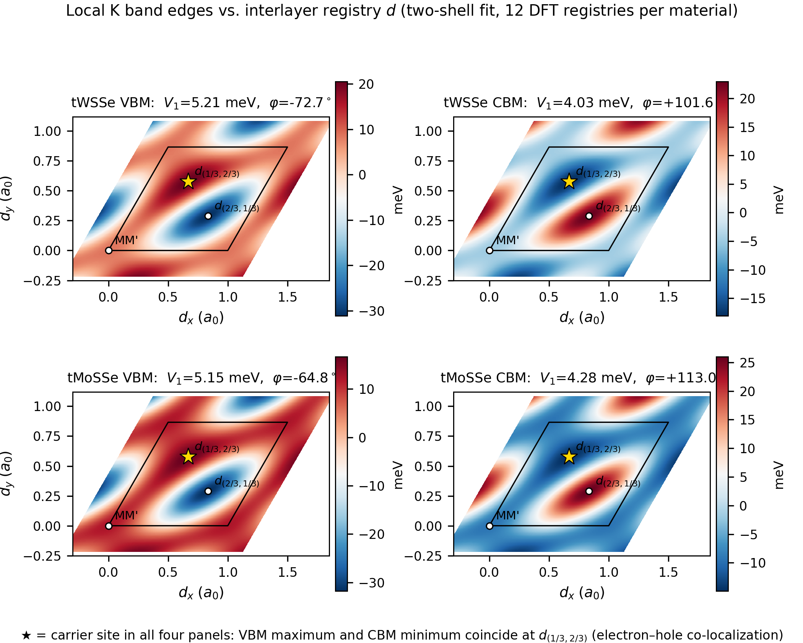
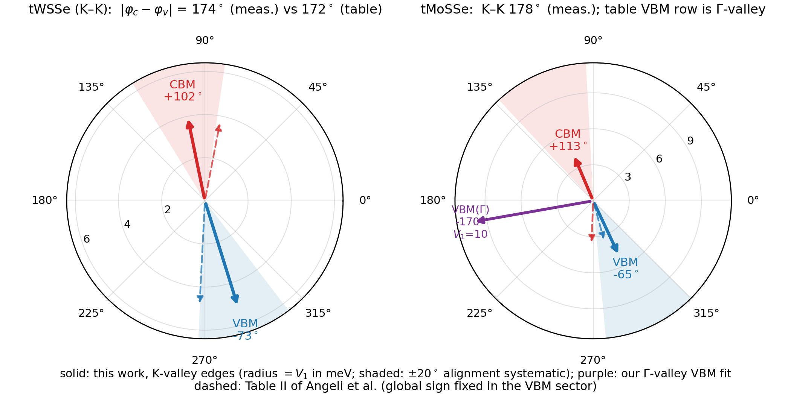

# Electron–hole co-localization in twisted Janus WSSe and MoSSe bilayers

**A registry-resolved DFT determination of the K-edge moiré phases**

> **Status: in revision — a centre-of-mass mass error was found in an internal audit; quantities depending on it are being recomputed and are not reported here.**
>
> Manuscript in preparation (unpublished). This repository reports only the registry-resolved DFT results, which do not depend on the exciton centre-of-mass mass: the fitted moiré amplitudes and phases, the site assignment, and the local-gap contrast. Addressing separations, zero-point energies, emitter band widths and the associated figures are intentionally omitted until the recalculation is complete.

## Question

The phases of the moiré potential decide whether electrons and holes in a twisted bilayer collect on the **same** superlattice site (a bright, self-addressed emitter array) or on **opposite** sites (a charge-separating texture). For polar, R-stacked Janus bilayers this question rested on a single published parameter table [Angeli *et al.*, PRB **106**, 235159 (2022); Erratum PRB **109**, 199902 (2024)]. Do the carriers co-localize?

## Method

- WSSe and MoSSe homobilayers, R-type stacking with parallel layer dipoles (S–M–Se | S–M–Se).
- Rigid local-stacking (adiabatic) picture: the moiré potential of a band edge is its dependence on interlayer registry **d**. 12 registries per material: MM′, the two B-type stackings d=(1/3,2/3) and (2/3,1/3), and a 3×3 grid.
- **Quantum ESPRESSO** 7.4.1, PBE + Grimme-D3, norm-conserving pseudopotentials with metal semicore states, self-consistent dipole correction (cell dipole 0.31–0.34 D), 90 Ry, 6×6×1 k-mesh; in-plane rigid registry, all z coordinates relaxed (interlayer distance 3.16–3.75 Å across registries).
- Eigenvalue alignment across independent slab runs on the layer-averaged metal-s semicore levels (raw semicore spread across registries is 38–57 meV, the same order as the moiré modulation). Alignment systematic on phases: ±20°.
- Two-shell, C₃-closed Fourier fit of each band edge; residuals rms ≤ 2.3 meV (VBM), ≤ 1.7 meV (CBM); V₂/V₁ ≤ 0.04.
- Spin–orbit (noncollinear, QE 7.5) runs at the B registries to fix the Γ/K valence ordering.

## Key results (independent of the centre-of-mass mass)

| | | V₁ (meV) | φ₁ | Ref. table V₁ | Ref. table φ₁ |
|---|---|---|---|---|---|
| tWSSe | VBM (K) | 5.21 | −72.7° | 4.9 | −92.9° |
| | CBM (K) | 4.03 | +101.6° | 3.8 | +79.1° |
| tMoSSe | VBM (K) | 5.15 | −64.8° | — | — |
| | VBM (Γ) | 10.2 | −170° | 3.6 | −74.6° |
| | CBM (K) | 4.28 | +113.0° | 3.7 | −92.3° |

- **K–K phase separation** |φc − φv| = **174°** (WSSe; table 172°) and **178°** (MoSSe). Anti-phased band edges co-localize the carriers.
- **Convention-free site verdict**, read directly from the aligned high-symmetry data: in both materials the VBM maximum and the CBM minimum sit at the **same** registry d=(1/3,2/3). Relative to the opposite B site: WSSe VBM +58 meV, CBM −46 meV; MoSSe +54 and −46 meV. The Γ-valley valence maximum also lies at d=(1/3,2/3) in both materials (+20 / +18 meV).
- **Local K-gap contrast** between the two B sites (reference-free, a difference of gaps): **−103.8 meV (WSSe), −100.2 meV (MoSSe)** in the rigid-registry limit.
- The tabulated tMoSSe VBM row is a Γ-valley hole, so a MoSSe phase-number comparison with the table is not like-for-like; the comparison is made on the site assignment, which confirms the table's localization-site (MSL) column. A single sign flip of the tabulated MoSSe CBM phase would reconcile the table with its own MSL column. The 2024 Erratum does not change the Table II phase entries.
- Closed-form cross-check: at the B sites shell 2 cancels exactly, giving Δ = −6√3 V₁ sin φ₁; the fitted values reproduce the direct reads with a uniform 10–11% deficit (truncation of shells ≥ 3, not a fit failure).

*Fig. 1. Local K band edges vs. interlayer registry (two-shell fit to 12 DFT registries). The K-valley VBM maximum and CBM minimum coincide at d=(1/3,2/3) in both materials.*

*Fig. 2. Measured first-star phases (solid; radius = V₁; wedges = ±20° systematic) vs. the published table (dashed).*

## Limiting results and open items

- Spin–orbit coupling is not included in the registry scan. Without SOC the Γ valence edge lies above K (by 41 meV in WSSe at the emitter registry). With full SOC, WSSe has its VBM at **K**, 145 meV above Γ. The MoSSe SOC run is still in progress; for MoSSe the lowest exciton may be momentum-indirect (Γ–K), pending that check.
- Γ-valley amplitudes and phases are the least robust numbers (most sensitive to interlayer distance) and are not used for conclusions.
- Rigid-registry scan (no in-plane relaxation); amplitude differences of ~6–16% from the large-cell reference are expected.
- These Janus bilayers have not yet been fabricated.

## Verification

- Site verdict and gap contrast are fit-free and alignment-reference-free.
- The closed-form B-site formula cross-checks the Fourier fit against the direct reads.
- The C₃ phase convention was checked by a ring-closure test; the corrected equation form of the 2024 Erratum matches the adopted convention.

## Repository contents

- `results/` — registry fit (`registry_fit_fazlar.json`), raw registry summaries (`registry_tarama_*.csv`), extracted Γ/K band energies for all 24 runs (`registry_bantlar.json`), WSSe SOC result (`soc_sonuc.json`).
- `dft/registry_inputs/` — Quantum ESPRESSO relax and band input files for all 24 registry runs; `dft/monolayer/` — monolayer vc-relax and SOC inputs and generator scripts.
- `scripts/` — registry driver (`drive_registry.py`) and band-data extractor (`cikar_bant_verisi.py`; edit the source path at its top to your run directory).
- `paper/ABSTRACT.md` — extended abstract.

Large output files and wavefunctions are not included. Some file and variable names are in Turkish.

## Reproducing

1. Download pseudopotentials (`dft/monolayer/setup.sh`) and run the monolayer vc-relax.
2. Run the 24 registry relax + band calculations (`dft/registry_inputs/`, Quantum ESPRESSO ≥ 7.4).
3. Extract band edges with `scripts/cikar_bant_verisi.py` and fit the two-shell model.

## Related work by the author

- Twisted hBN moiré artificial atoms: https://doi.org/10.5281/zenodo.24201814
- Twisted MoS₂ hole-spin coherence: https://www.alphaxiv.org/abs/2611.twisted-mos2-hole-spin-coherence
- Moiré microwave loss: https://doi.org/10.5281/zenodo.24204124

## AI assistance

AI assistance: AI coding assistants were used for code development and for adversarial review. All load-bearing results were re-derived by independent methods and checked by automated tests; the author is responsible for every claim.

## Citation

Faruk Sami Bilgin (Independent Researcher, ORCID [0009-0001-9064-4410](https://orcid.org/0009-0001-9064-4410)), *Electron–hole co-localization in twisted Janus WSSe and MoSSe bilayers: a registry-resolved DFT determination of the K-edge moiré phases*, manuscript in preparation (2026). See `CITATION.cff`.

License: code MIT (`LICENSE`); text, figures and data CC BY 4.0 (`LICENSE-CONTENT`).
